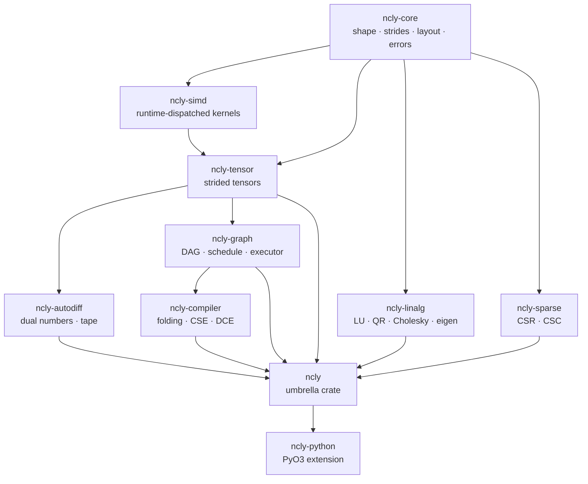

# NCLY

**Numerical computing for Rust.** N-dimensional strided tensors, forward- and
reverse-mode automatic differentiation, dense linear algebra and sparse solvers —
in one dependency-light workspace, with Python bindings.

<p>
  
  
  
</p>

> Every number in this README, every badge and every claim corresponds to
> something in this repository that you can reproduce. Where a feature is not
> finished, it is listed as unfinished.

---

## Contents

1. [Identity](#identity)
2. [What NCLY does](#what-ncly-does)
3. [Features](#features)
4. [Architecture](#architecture)
5. [Mathematical foundations](#mathematical-foundations)
6. [Installation](#installation)
7. [Quick start](#quick-start)
8. [Rust examples](#rust-examples)
9. [Python examples](#python-examples)
10. [How autodiff works](#how-autodiff-works)
11. [Tensors and sparsity](#tensors-and-sparsity)
12. [Performance](#performance)
13. [Project layout](#project-layout)
14. [Testing](#testing)
15. [Roadmap](#roadmap)
16. [Contributing](#contributing)
17. [License and acknowledgments](#license-and-acknowledgments)

---

## Identity

NCLY is an independent numerical-computing library. It is written from scratch:
no source code, documentation or branding is copied from ndarray, faer, nalgebra,
burn, candle, PyO3 or maturin. Those projects were studied for *architectural
lessons* — how they separate layout from storage, how they dispatch SIMD, how they
document — and the conclusions are recorded in [`docs/architecture.md`](docs/architecture.md).

The design goal is narrow and deliberate: **a small library whose numerical
routines are correct and whose behaviour is documented**, rather than a large
library with broad API coverage. Every crate in the workspace does something real.

## What NCLY does

Given a scalar function of tensors, NCLY can compute its gradient exactly, and it
can factor, solve and analyse matrices numerically:

$$
y = \sum_i (x_i^2) + \sin(x_0), \qquad \nabla_x y = 2x + \cos(x_0)\,e_0
$$

```rust
use ncly::autodiff::{Tape, Variable};
use ncly::Tensor;

let tape = Tape::new();
let _guard = Variable::with_tape(&tape);
let x = Variable::auto_tensor(Tensor::from_vec(vec![1.0, 2.0, 3.0], [3])?, "x");
let y = x.mul(&x).sum();           // y = Σ xᵢ²
y.backward();
assert_eq!(x.grad().to_vec(), vec![2.0, 4.0, 6.0]);
# Ok::<(), ncly_core::NclyError>(())
```

## Features

**Tensors**

- N-dimensional row-major arrays with explicit shape/strides/offset (`ncly-core`)
- Views: `transpose`, `permute`, `narrow`, `broadcast_to`, `reshape` — all `O(rank)`
- NumPy broadcasting by zero-stride insertion, then loop collapsing for speed
- Element-wise `+ − × ÷`, `pow`, `exp`, `ln`, `sqrt`, `sin`, `cos`, `tanh`, `abs`
- Reductions: `sum`, `mean`, `max`, `min`, `dot`, with compensated summation
- Matrix product, rank-2 and batched rank-3

**Automatic differentiation**

- Forward mode via dual numbers (`Dual`), giving Jacobian-vector products
- Reverse mode via a linear tape (`Variable`, `Tape`), giving full gradients
- Rules for `+ − × ÷`, `pow`, `exp`, `ln`, `sqrt`, `sin`, `cos`, `tanh`, `abs`,
  `maximum`, `sum`, `mean`, `matmul`, `reshape`, `transpose`, broadcasting
- Gradient accumulation across `backward()` calls, matching PyTorch semantics

**Linear algebra**

- LU with partial pivoting, `solve`, `inverse`, `det`
- Householder QR, least squares (`lstsq`), residual norms
- Cholesky (`L Lᵀ`) with indefiniteness detection
- Symmetric eigen-decomposition (cyclic Jacobi) and general eigenvalues
  (Householder Hessenberg + implicitly shifted QR with Givens rotations),
  validated against `numpy.linalg.eigvals` on random non-symmetric matrices

**Sparse**

- CSR and CSC with `O(nnz)` conversion, duplicate summation, sorted rows
- `spmv`, `spmm`, sparse addition, transpose, dense conversion

**Python**

- `ncly` extension module built with PyO3 + maturin (`abi3-py38`)
- `Tensor` for values, `GradTensor` for tape-based gradients, `CsrMatrix` for sparse
- Errors map onto Python types (`ValueError`, `ZeroDivisionError`, `ArithmeticError`)

**Graph and compiler**

- `ncly-graph`: append-only DAG with eager shape inference, level scheduling and
  checked execution
- `ncly-compiler`: constant folding (a folded subgraph collapses to one baked
  leaf value), common-subexpression elimination, dead-node elimination —
  exercised by running [`examples/graph.rs`](examples/graph.rs) in CI
- Operator **fusion is not implemented** — there is no fused kernel or JIT, so
  `exp → mul → sum` still makes three passes over memory (see [Roadmap](#roadmap))

**Not implemented** (see [Roadmap](#roadmap)): GPU backends, multithreading,
operator fusion, complex numbers, higher-order derivatives, generic scalar types.

## Architecture



Dependencies point strictly downwards, which is why `ncly-linalg` and
`ncly-sparse` can be used without pulling in the tensor engine. Details and the
invariants each layer maintains: [`docs/architecture.md`](docs/architecture.md).

## Mathematical foundations

### Broadcasting

An operand with shape $(d_0, \dots, d_{n-1})$ and strides $(s_0, \dots, s_{n-1})$
is extended to a larger shape by **inserting zero strides** on new and expanded
axes. The flat address of logical index $\mathbf{i}$ is

$$
\mathrm{addr}(\mathbf{i}) = \mathrm{base} + \sum_{k=0}^{n-1} i_k\, s_k ,
$$

and $s_k = 0$ makes the tensor independent of axis $k$ — which is exactly what
broadcasting means, with no data movement.

### Contraction (matmul)

$$
C_{ij} = \sum_{p=0}^{k-1} A_{ip}\, B_{pj}
$$

implemented as a sequence of AXPY updates over contiguous rows of $B$, so the
inner loop is a vectorisable `fma`.

### LU with partial pivoting

For $P A = L U$ with $L$ unit lower triangular:

$$
u_{ij} = a_{ij} - \sum_{k<i} l_{ik} u_{kj},
\qquad
l_{ij} = \frac{1}{u_{jj}}\left(a_{ij} - \sum_{k<j} l_{ik} u_{kj}\right)
$$

A pivot is rejected when $|u_{jj}| \le \tau \lVert A \rVert_\infty$ (relative, not
absolute, so badly scaled matrices still factor).

### Householder QR

Reflectors $H_k = I - \tau_k v_k v_k^{\mathsf T}$ zero the sub-diagonal column by
column:

$$
\underbrace{H_{n-1}\cdots H_0}_{Q^{\mathsf T}} A = R ,
\qquad Q = H_0 \cdots H_{n-1} .
$$

The *order* in which reflectors are applied matters and is the easiest thing to
get wrong: $Q^{\mathsf T} b$ applies $H_0$ first, while forming $Q$ itself applies
$H_{n-1}$ first.

### Cholesky

For symmetric positive definite $A$:

$$
\ell_{jj} = \sqrt{a_{jj} - \sum_{k<j} \ell_{jk}^2},
\qquad
\ell_{ij} = \frac{1}{\ell_{jj}}\left(a_{ij} - \sum_{k<j} \ell_{ik}\ell_{jk}\right)
$$

A negative radicand proves indefiniteness and is reported as
`NclyError::NotPositiveDefinite` rather than silently producing `NaN`.

### Reverse-mode gradients

With adjoints $\bar{x}_i = \partial L / \partial x_i$ and local Jacobians
$J_{ij} = \partial y_i / \partial x_j$:

$$
\bar{x}_j \mathrel{+}= \sum_i \bar{y}_i\, J_{ij}
$$

For `matmul`, $J$ is not element-wise: $\bar A = \bar C B^{\mathsf T}$ and
$\bar B = A^{\mathsf T}\bar C$. NCLY encodes that in the type system
(`LocalGrad::MatmulLeft` / `MatmulRight`) so the element-wise mistake cannot be
made.

### Jacobi eigenvalue iteration

Zero the largest off-diagonal entry with a plane rotation $G(p,q,\theta)$ where

$$
\theta = \tfrac12 \mathrm{atan2}\left(2a_{pq},\; a_{qq} - a_{pp}\right),
$$

accumulating $V \leftarrow VG$; the diagonal converges to the eigenvalues and the
columns of $V$ to the eigenvectors.

### Compensated summation

Kahan-Babuska-Neumaier accumulation tracks a running compensation term:

$$
s \leftarrow s + x, \qquad
t = \begin{cases} (s - s_{\text{old}}) - x & |s| \ge |x| \\ (x - (s - s_{\text{old}})) & \text{otherwise} \end{cases},
\qquad c \leftarrow c + t
$$

and the result is $s + c$. This keeps the relative error of a long sum near
$\varepsilon$ rather than growing with the number of terms, at the cost of one
extra addition and one comparison per element.

## Installation

NCLY is not published on crates.io yet; use it as a path or git dependency:

```toml
[dependencies]
ncly = { git = "https://github.com/zomop/ncly", branch = "main" }
```

Requires Rust 1.75 or newer.

For the Python bindings:

```bash
git clone https://github.com/zomop/ncly
cd ncly/python
python -m pip install maturin
maturin build --release
python -m pip install --force-reinstall target/wheels/ncly-*.whl
```

## Quick start

```rust
use ncly::Tensor;
use ncly::autodiff::{Tape, Variable};

fn main() -> ncly::Result<()> {
    // Tensors
    let a = Tensor::from_vec(vec![1.0, 2.0, 3.0, 4.0], [2, 2])?;
    let b = Tensor::from_vec(vec![1.0, 0.0, 0.0, 1.0], [2, 2])?;
    assert_eq!(a.matmul(&b)?.to_vec(), a.to_vec());
    assert_eq!(a.transpose().shape().dims(), &[2, 2]);

    // Auto-differentiation
    let tape = Tape::new();
    let _guard = Variable::with_tape(&tape);
    let x = Variable::auto_tensor(Tensor::from_vec(vec![1.0, 2.0], [2])?, "x");
    let y = x.mul(&x).sum();
    y.backward();
    assert_eq!(x.grad().to_vec(), vec![2.0, 4.0]);

    // Linear algebra
    let solution = ncly::linalg::solve(&[4.0, 3.0, 6.0, 3.0], &[10.0, 12.0], 2)?;
    assert!((solution[0] - 1.0).abs() < 1e-12);
    Ok(())
}
```

## Rust examples

Runnable files live in [`examples/`](examples):

| Example | Demonstrates |
| --- | --- |
| `tensors.rs` | broadcasting, views, reductions |
| `autodiff.rs` | forward vs reverse mode on the same function |
| `linalg.rs` | LU, QR least squares, Cholesky, eigenvalues |
| `sparse.rs` | assembling a 1-d Laplacian and multiplying |
| `graph.rs` | a dataflow graph, its schedule, and the optimiser's effect |

```bash
cargo run --release -p ncly --example tensors
cargo run --release -p ncly --example graph
```

## Python examples

```python
import ncly

# `requires_grad()` opts the tensor into the tape; it is a method, not a flag.
x = ncly.Tensor([1.0, 2.0, 3.0]).requires_grad()
y = (x * x).sum()
y.backward()
print(x.grad.tolist())      # [2.0, 4.0, 6.0]

print(ncly.solve([[4.0, 3.0], [6.0, 3.0]], [10.0, 12.0]))   # [1.0, 2.0]
```

The tests under [`python/tests`](python/tests) are the executable specification
of what the bindings support; anything not covered there is not claimed.

## How autodiff works

Two independent engines share one contract.

**Forward mode** uses dual numbers, $x + \dot{x}\varepsilon$ with
$\varepsilon^2 = 0$. Every operation is a ring operation, so the chain rule is
free:

$$
(a + \dot a\varepsilon)(b + \dot b\varepsilon)
= ab + (a\dot b + \dot a b)\varepsilon
$$

**Reverse mode** records each primitive on a tape as `(op, parents, local
gradient)`. Because a node is always appended after its parents, the tape index is
a topological order, and one reverse sweep accumulates every adjoint. Local
gradients are stored as an enum, not a closure:

```rust
pub enum LocalGrad {
    Elementwise(Tensor),   // ∂y/∂x element-wise (mask, scale, …)
    Permute(Vec<usize>),   // inverse of a transpose
    Reshape(Vec<usize>),   // back to the parent's shape
    MatmulLeft(Tensor),    // G·Bᵀ
    MatmulRight(Tensor),   // Aᵀ·G
    FixedIndex(Vec<usize>),// route the adjoint to the winning position
}
```

The distinction between `Elementwise` and `MatmulLeft` is the whole point: using a
mask for matmul silently produces wrong gradients for non-symmetric operands.

Full derivation, cost model and validation strategy: [`docs/autodiff.md`](docs/autodiff.md).

## Tensors and sparsity

A `Tensor` is `Arc<Vec<f64>>` plus a `Layout` `(shape, strides, offset)`. Views
share storage; writes copy-on-write. Binary operations plan the broadcast, insert
zero strides, then **collapse** adjacent axes that can be merged without changing
the address arithmetic, so a contiguous tensor runs as one flat loop:

```text
(2, 3, 4) strides (12, 4, 1)
  fuse axes 1,2  → 12 elements, stride 1
  fuse axes 0,1  → 24 elements, stride 1
```

Sparse matrices store sorted rows (CSR) or columns (CSC). Triplets are merged with
duplicate summation, and explicit zeros are preserved because dropping them would
change the sparsity pattern the caller asked for. `spmv` walks rows and accumulates
into the output; `spmm` walks rows of $A$ once and scatters through the matching
row of $B$.

## Performance

NCLY does not publish performance claims it has not measured. The benchmark
runner in [`benchmarks/`](benchmarks) is dependency-free and reproducible:

```bash
cargo run --release -p ncly-benchmarks            # all cases
cargo run --release -p ncly-benchmarks matmul     # filter by name
cargo run --release -p ncly-benchmarks -- --json  # machine-readable
```

It reports the median and best wall time over repeated runs together with derived
throughput (GFLOP/s for matmul, GiB/s for memory-bound kernels). The measured
figures — with the machine, toolchain and flags they came from — are in
[`BENCHMARKS.md`](BENCHMARKS.md) and nowhere else.

Three data points from that file, chosen because they are honest rather than
flattering:

- single-threaded `matmul` reaches 12.3–13.4 GFLOP/s for 64–256 and drops to 11.0
  at 512×512 — a missing register-blocked GEMM, and the reason multithreading is on
  the roadmap;
- `tensor add` moves about 17.7 GiB/s against 100.3 GiB/s for a bare `axpy` on the
  same element count — the cost of the broadcast plan around the kernel;
- the optimiser takes a graph with a repeated constant subexpression from 0.704 ms
  to 0.576 ms, and the optimised graph needs no constant inputs at all.

Runs on a shared CI vCPU differ by roughly 10–40%, so quote the ranges, not the
point values. The figures above are from a single green run whose log is attached
to that commit; the machine is named in `BENCHMARKS.md`.

## Project layout

```text
crates/
  ncly-core       shapes, strides, layouts, errors          (no dependencies)
  ncly-simd       kernel families + runtime CPU detection
  ncly-tensor     tensors, broadcasting, element-wise ops
  ncly-autodiff   dual numbers, tape, gradient rules
  ncly-linalg     LU, QR, Cholesky, eigen, solvers
  ncly-sparse     CSR/CSC, spmv, spmm
  ncly            umbrella crate
  ncly-python     PyO3 bindings
  ncly-graph      DAG, shape inference, level schedule, executor
  ncly-compiler   constant folding, CSE, dead-node elimination
python/           maturin package + pytest suite
tests/integration numerical validation across crates
benchmarks/       reproducible timing harness
docs/             architecture, autodiff, tensor engine, numerical methods
```

## Testing

```bash
cargo fmt --check
cargo clippy --workspace --all-targets -- -D warnings
cargo test --workspace
RUSTDOCFLAGS="-D warnings" cargo doc --workspace --no-deps
cd python && maturin build --release && pytest -q
```

Correctness is checked four ways:

- **Reference implementations** — every linalg routine is verified by residual
  ($\lVert A - LU \rVert$, $\lVert A - QR \rVert$, $\lVert Q^{\mathsf T}Q - I \rVert$,
  $\lVert Av - \lambda v \rVert$).
- **Finite differences** — gradients are compared to central differences with a
  step of $h \approx \varepsilon^{1/3}\max(1, |x|)$, the error-balanced choice.
- **Forward vs reverse** — the two autodiff engines share no code; agreement is
  independent evidence.
- **Structural invariants** — `reshape`/`transpose` preserve gradient mass,
  broadcasting adjoints sum to the operand's shape, collapse keeps the fast stride.

## Roadmap

| Milestone | State |
| --- | --- |
| Workspace, core types, tensors | done |
| Tensor operations and validation | done |
| Autodiff (forward + reverse) | done |
| Dense linear algebra | done |
| Sparse CSR/CSC | done |
| SIMD kernels and benchmark harness | done |
| Python bindings | done |
| Documentation, examples, CI | done |
| Computational graph scheduler (`ncly-graph`) | done |
| Optimising passes: CSE, DCE, constant folding (`ncly-compiler`) | done |
| Operator fusion (`exp → mul → sum` in one pass) | **not implemented** |
| Multithreaded kernels | **planned** |
| GPU backend | **deferred** |

## Contributing

Bug reports, numerical-accuracy reports and documentation fixes are welcome. See
[`CONTRIBUTING.md`](CONTRIBUTING.md) for the review checklist (every numerical
change needs a residual test or a finite-difference check) and
[`CODE_OF_CONDUCT.md`](CODE_OF_CONDUCT.md) for community expectations. Security
reports follow [`SECURITY.md`](SECURITY.md).

## License and acknowledgments

MIT — see [`LICENSE`](LICENSE).

NCLY was designed after studying several open-source projects; their ideas shaped
this architecture, and no code was taken from them:

- [ndarray](https://github.com/rust-ndarray/ndarray) — layout/strides as a
  first-class concept
- [faer](https://github.com/sarah-quinones/faer-rs) — block-oriented dense kernels
- [nalgebra](https://github.com/dimforge/nalgebra) — typed linear-algebra API
- [burn](https://github.com/tracel-ai/burn) and
  [candle](https://github.com/huggingface/candle) — tensor-backend separation
- [PyO3](https://github.com/PyO3/pyo3) and
  [maturin](https://github.com/PyO3/maturin) — Python packaging
- [BLAS](https://www.netlib.org/blas/) and [LAPACK](https://www.netlib.org/lapack/)
  — the reference algorithms for the factorisations
