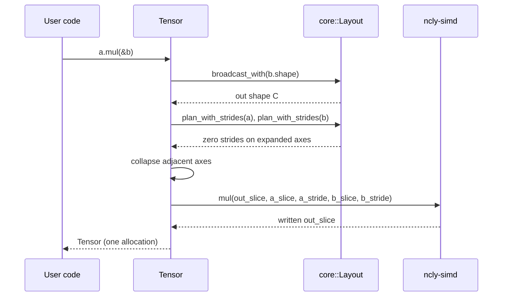

# NCLY architecture

This document describes *why* the crate graph looks the way it does, how data
moves through the engine, and which invariants each layer is responsible for
maintaining. It is the reference for anyone changing internals.

## Crate graph

```mermaid
graph TD
    core[ncly-core<br/><i>shapes, strides, layouts, errors</i>]
    simd[ncly-simd<br/><i>kernels, CPU dispatch</i>]
    tensor[ncly-tensor<br/><i>strided tensors, element-wise math</i>]
    autodiff[ncly-autodiff<br/><i>dual numbers, tape</i>]
    linalg[ncly-linalg<br/><i>LU, QR, Cholesky, eigen</i>]
    sparse[ncly-sparse<br/><i>CSR, CSC</i>]
    graph[ncly-graph<br/><i>DAG, shape inference, schedule</i>]
    compiler[ncly-compiler<br/><i>folding, CSE, DCE</i>]
    facade[ncly<br/><i>umbrella crate</i>]
    python[ncly-python<br/><i>PyO3 extension</i>]

    core --> tensor
    simd --> tensor
    tensor --> autodiff
    core --> autodiff
    core --> linalg
    core --> sparse
    tensor --> facade
    autodiff --> facade
    linalg --> facade
    sparse --> facade
    facade --> python
    autodiff --> python
    linalg --> python
    sparse --> python
    tensor --> graph
    graph --> compiler
```

The dependency direction is strictly downwards. `ncly-core` depends on nothing,
which is what lets `ncly-linalg` and `ncly-sparse` be used stand-alone (they do
not pull in the tensor engine), and lets `ncly-autodiff` depend on the tensor
engine without creating a cycle. `ncly-graph` builds on tensors, and
`ncly-compiler` builds only on the graph, so the optimiser has no numeric code of
its own.

## The layered invariants

### 1. `ncly-core` — structural truth

| Type | Invariant |
| --- | --- |
| `Shape` | Produced only through constructors that never overflow silently. `size()` is the product of the axes. |
| `Strides` | Row-major canonical form is `(Π dims[1..], …, 1)`. |
| `Layout` | `shape` + `strides` + `offset`; `span()` is an exclusive upper bound on every address the layout can touch. |
| `NclyError` | Every failure mode is a variant; there is no `Box<dyn Error>` in hot paths. |

The critical rule for the whole engine is:

> **Broadcasting never changes an operand's strides; it only inserts `0` strides
> on new or expanded axes.**

`Layout::broadcast_to` implements exactly that, using the operand's *actual*
strides rather than canonical ones — a transposed operand must keep its own
strides or the kernel reads the wrong memory.

### 2. `ncly-simd` — one kernel family per machine

Runtime dispatch happens once per process (`OnceLock`), then every call goes
straight to the selected kernel. The kernels take `(slice, stride)` pairs so
that zero-stride broadcasting and transposed views both work without a copy.

Correctness contract: for `add`, `sub`, `mul`, `scale`, `copy` the vector and
scalar paths are bit-identical because IEEE-754 addition and multiplication are
exactly rounded and NCLY never reassociates them. For `sum`/`dot`, the scalar
path uses Neumaier compensation while the vector paths use per-lane partial
sums; they agree to rounding, and the test suite brackets that difference.

### 3. `ncly-tensor` — the engine

A `Tensor` is `Arc<Vec<f64>>` + `Layout`. Views (`transpose`, `narrow`,
`broadcast_to`, `permute`) are `O(rank)` and share storage.

Binary operations go through a three-step pipeline:

1. Compute the broadcast shape `C`.
2. **Collapse** adjacent axes where `stride_i == len_j · stride_j` for every
   operand, producing a short list of loop axes. A `(2, 3, 4)` contiguous
   operand collapses to a single axis of length 24.
3. Run the innermost axis through `ncly-simd`, then advance an odometer over the
   outer axes.

The collapse rule is the piece most likely to be broken by well-meaning
"optimisations", because the merged axis must retain the **fastest** stride.
`crates/ncly-tensor/src/ops.rs` has a unit test that asserts the retained
stride directly, in addition to the behavioural tests.

Reductions normalise to a contiguous buffer and then reduce with a stride over
the reduced axis, which keeps the inner loop simple and lets the compiler
vectorise it. Compensated summation is used on the scalar path so that a
`1e6`-element sum is accurate to a few ulps of the *result*, not of the largest
term.

### 4. `ncly-autodiff` — two engines, one contract

Forward mode is a `Dual` type: `v + dε`, `ε² = 0`. No allocation, no tape.

Reverse mode records nodes in a `Vec` on a `Tape` (`Arc<Mutex<Vec<Node>>>`).
Because nodes are appended after their parents, the tape index *is* the
topological order, so a backward sweep is one reverse `for` loop.

Local gradients are expressed as a `LocalGrad` enum rather than as a closure:

```rust
enum LocalGrad {
    Elementwise(Tensor),   // multiply, then reduce broadcasting
    Permute(Vec<usize>),   // undo a transpose
    Reshape(Vec<usize>),   // undo a reshape
    MatmulLeft(Tensor),    // G·Bᵀ
    MatmulRight(Tensor),   // Aᵀ·G
}
```

The enum matters for *correctness*, not just for tidiness: `matmul`'s adjoint is
a matrix product, and getting that wrong (using an element-wise product) is a
classic bug that unit tests catch only if they check a non-symmetric case.

Backward semantics follow PyTorch: leaf adjoints accumulate across `backward()`
calls (so gradient accumulation works), while intermediate adjoints are reset at
the start of every sweep (so shared subexpressions are not double-counted).

### 5. `ncly-linalg` — stability first

| Routine | Algorithm | Why |
| --- | --- | --- |
| LU | Right-looking elimination, partial pivoting | `2n³/3` flops; smallest constant of the pivoting methods |
| QR | Householder reflectors | Unconditionally stable; the reflector application order is the subtle part |
| Cholesky | `L Lᵀ` | Half the work of LU, and indefiniteness is *detected*, not hidden |
| Symmetric eigen | Cyclic Jacobi | Very accurate eigenvectors for graded matrices; no shift heuristics |
| General eigen | Hessenberg + shifted QR | Needed for non-symmetric input; reports complex pairs |

Pivot rejection uses a **relative** test, `|pivot| ≤ tol · ‖A‖_∞`, so a matrix
scaled by `1e-300` factors correctly while a truly singular one is reported as
`NclyError::Singular { pivot }`.

### 6. `ncly-sparse` — structure is data

CSR for row access, CSC for column access, `O(nnz)` conversion between them by
counting sort. Triplets are merged with duplicate summation, and each row/column
is sorted so that the merge-based kernels (`add`, `spmm`) are linear.

Explicit zero entries supplied as triplets are **kept**: dropping them would
change the sparsity pattern the caller asked for, which matters for
preconditioners and for structural analysis.

## Data flow of one operation



## Graph and compiler layers

`ncly-graph` sits directly above `ncly-tensor` and holds no state of its own
beyond the node list, so it is trivially cloneable and inspectable.

The central invariant is that **node ids are a topological order**: a node is
created only after its inputs, and `add_node` validates every parent id, so a
cycle cannot be represented. Shape inference runs inside `add_node`; a graph with
mismatched shapes cannot be constructed, which means `plan` and `run` never have
to re-check operand compatibility.

```
Graph::input(shape, name) -> NodeId      // leaf, shape fixed
Graph::add_node(op, &[NodeId]) -> NodeId // parents checked, shape inferred now
Graph::plan() -> Schedule                // level = max(parent level) + 1, cost-sorted
Graph::run(outputs, values) -> Execution // verifies each produced shape
```

`Node::value` carries a baked constant. A folded literal therefore executes with
an empty value map, which is what makes constant folding a real optimisation
rather than a bookkeeping change.

`ncly-compiler` rebuilds the graph in one forward pass, applying, in order:
constant folding, CSE (hash-consing `Signature { op, inputs }`), and dead-node
elimination (reachability from the requested outputs). Rewrites are conservative:
constant operands must *all* be known, and no pass reassociates floating-point
arithmetic.

Operator fusion is **not** implemented: it needs a fused kernel per supported
pattern or a JIT. See [`ROADMAP.md`](../ROADMAP.md).

## Testing strategy

| Layer | Tests |
| --- | --- |
| core | property-style tests over shapes/strides, index round-trips |
| simd | every length 0..37 against a scalar reference, bit-exactness |
| tensor | broadcasting vs an independent reference implementation, collapse invariants |
| autodiff | finite differences, forward-vs-reverse agreement, matmul/reshape adjoints |
| linalg | `‖A − LU‖`, `‖A − QR‖`, `‖QᵀQ − I‖`, eigenpair residuals |
| sparse | dense-reference agreement for `spmv`, `spmm`, `add`, conversions |
| graph | shape inference per op, scheduling order, execution against dense reference |
| compiler | folded/CSE/DCE counts against hand-computed expectations, output equality |
| python | pytest suite run against the built extension in CI |
