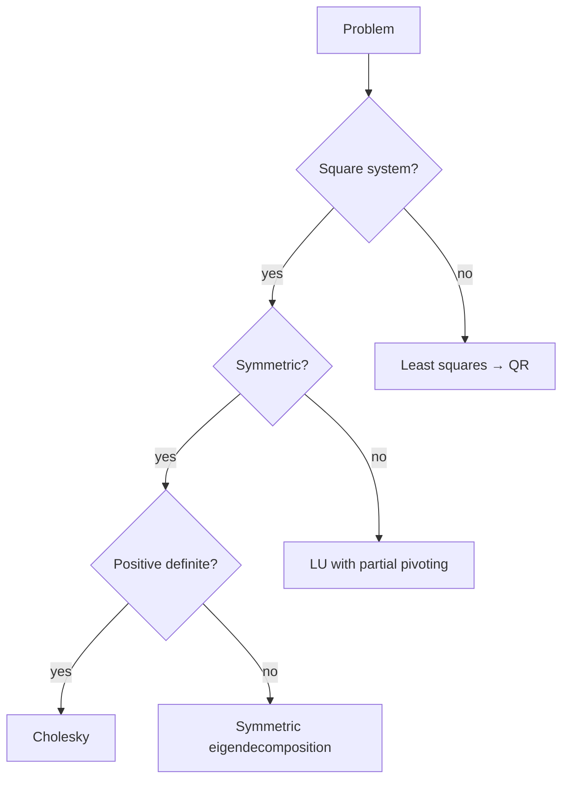

# Numerical methods

The algorithms NCLY uses, why they were chosen, and the accuracy you should
expect. This is the reference for anyone checking whether a result is "wrong" or
merely at the limit of what the method guarantees.

Throughout: `ε ≈ 2.2e-16` is unit roundoff for `f64`, `κ(A)` is the 2-norm
condition number, and `n` is the matrix order.

## Choosing an algorithm

| Problem | Routine | Cost | Backward error |
| --- | --- | --- | --- |
| `A x = b`, general | `lu::Lu::factor` + `solve` | `2n³/3` | `O(nε)` |
| `A x = b`, SPD | `cholesky::Cholesky::factor` | `n³/3` | `O(nε)` |
| `min ‖A x − b‖₂`, `m ≥ n` | `qr::Qr` + `lstsq` | `2mn²` | `O(mnε)` |
| Eigenvalues, symmetric | `eigen::symmetric` (Jacobi) | `O(n³)` per sweep | `O(nε)` |
| Eigenvalues, general | `eigen::eigenvalues` | `~10n³` | `O(nε)·growth` |

## LU with partial pivoting

Right-looking elimination:

$$
u_{ij} = a_{ij} - \sum_{k<i} l_{ik} u_{kj}, \qquad
l_{ij} = \frac{1}{u_{jj}}\Bigl(a_{ij} - \sum_{k<j} l_{ik} u_{kj}\Bigr)
$$

**Pivot test.** A column is declared singular when

$$
|u_{jj}| \le \tau \, \lVert A \rVert_\infty, \qquad \tau = 10^{-12} \text{ (default)}
$$

The test is *relative*, so a matrix scaled by `1e-300` factors exactly as well as
the same matrix scaled by `1e300`. An absolute test would call the former singular
and the latter perfectly conditioned.

**Accuracy.** With partial pivoting the growth factor is bounded by `2^{n-1}` in
theory but is `O(1)` in practice; the computed solution satisfies
`(A + ΔA)x = b` with `‖ΔA‖ ≈ c(n) ε ‖A‖`. The error in `x` is then roughly
`κ(A) · n · ε`, so a condition number near `1e12` leaves only a few correct digits
— which is why `residual` is a separate function: a small residual does not imply
a small error.

**What it will not do.** NCLY does not do complete pivoting or iterative
refinement, so it cannot rescue a matrix whose growth factor is genuinely large.

## Householder QR

Column-by-column, zero the sub-diagonal with a reflector

$$
v = x + \operatorname{sign}(x_0)\lVert x\rVert_2 e_0, \qquad
H = I - \tau v v^{\mathsf T}, \qquad \tau = \frac{2}{v^{\mathsf T}v},
$$

chosen so that `H x = -sign(x₀) ‖x‖₂ e₀`. Then

$$
H_{n-1}\cdots H_0 A = R, \qquad Q = H_0 \cdots H_{n-1}.
$$

**The order trap.** Because `Q` is a product, applying `Q` to a vector means
applying `H_{n-1}` *first*; applying `Qᵀ` means applying `H_0` first. Getting this
backwards leaves `Q·R = A` correct while `Qᵀb` — and therefore every
least-squares solution — is wrong. NCLY's test suite checks both the
reconstruction *and* the solution against a known answer.

**Least squares.** For `m ≥ n`, solve `R x = Qᵀ b` by back substitution. The
residual norm is

$$
\lVert b - Ax \rVert_2 = \Bigl\lVert \bigl(Q^{\mathsf T}b\bigr)_{n:m} \Bigr\rVert_2 .
$$

**Accuracy.** Householder QR is unconditionally backward stable:
`‖ΔA‖ ≈ c(m,n) ε ‖A‖`. It is preferred over the normal equations, which square
the condition number (`κ(AᵀA) = κ(A)²`).

## Cholesky

For symmetric positive definite `A = L Lᵀ`:

$$
\ell_{jj} = \sqrt{a_{jj} - \sum_{k<j}\ell_{jk}^2}, \qquad
\ell_{ij} = \frac{1}{\ell_{jj}}\Bigl(a_{ij} - \sum_{k<j}\ell_{ik}\ell_{jk}\Bigr).
$$

A negative radicand is a *proof* of indefiniteness (up to rounding), reported as
`NclyError::NotPositiveDefinite`. NCLY compares the radicand against
`τ · trace(A)/n` rather than zero, so a matrix assembled with round-off-level
violations is still accepted.

**Accuracy.** Backward stable with `‖ΔA‖ ≈ c(n) ε ‖A‖`, and about half the work of
LU. It is the right choice whenever the problem is known to be SPD — a normal
equations system, a stiffness matrix, a kernel matrix.

## Symmetric Jacobi eigen-decomposition

Repeatedly zero one off-diagonal entry with a plane rotation `G(p,q,θ)`:

$$
\theta = \tfrac12\operatorname{atan2}\!\left(2a_{pq},\; a_{qq}-a_{pp}\right),
\qquad A \leftarrow G^{\mathsf T} A G .
$$

The sweep continues until the off-diagonal Frobenius norm is below
`τ ‖A‖_F`. `A` converges to `diag(λ)` and the accumulated `V` holds the
eigenvectors, so `A = V Λ Vᵀ` with `V` orthogonal to working precision.

**Why Jacobi.** Cyclic Jacobi is slower than tridiagonalisation plus implicit QR,
but it computes *small* eigenvalues and their eigenvectors with high relative
accuracy even when the spectrum is graded — exactly the case where the fast
algorithms lose vectors to cancellation. For matrices up to a few hundred, the
trade is worth it.

**Sign convention.** The second argument of `atan2` must be `a_qq − a_pp`. With
`a_pp − a_qq` the rotation goes the wrong way and the off-diagonal norm does not
decrease; NCLY has a regression test that fails on the wrong sign.

## General eigenvalues

Reduction to upper Hessenberg by Householder similarity, then the shifted QR
iteration (Wilkinson shift, deflation on a small sub-diagonal), yielding
eigenvalues as real or complex-conjugate pairs. This is only used when the input is
not symmetric; the symmetric path is preferred because it is both faster and more
accurate.

## Sparse kernels

| Operation | Algorithm | Cost |
| --- | --- | --- |
| `spmv` | row-wise gather | `O(nnz)` |
| `spmv_transpose` | column-wise gather via CSC | `O(nnz)` |
| `spmm` | row expansion with a dense accumulator per row | `O(nnz(A) · avg nnz(row of B))` |
| CSR ↔ CSC | counting sort | `O(nnz + n)` |
| `add` | sorted merge per row | `O(nnz(A) + nnz(B))` |

Duplicate coordinates are summed, and rows are sorted after assembly, so the merge
kernels can assume sortedness. Explicit zeros are preserved — they are
structurally meaningful.

**Fill-in.** `spmm` allocates its result by first counting the structural nonzeros
of each output row, so there is no reallocation during accumulation.

## Summation

Long sums use Neumaier compensation:

$$
s \leftarrow s + x, \quad
t = \begin{cases}(s_{\text{old}} - s) + x & |s| \ge |x| \\ x - (s - s_{\text{old}}) & \text{otherwise}\end{cases},
\quad c \leftarrow c + t,
$$

returning `s + c`. Naive accumulation of `n` terms has worst-case relative error
`n ε`; compensated accumulation holds it near `ε`. This matters for `mean` of a
million elements and for dot products with cancellation.

## Limits worth knowing

- **Conditioning.** No algorithm recovers digits lost to conditioning.
  `κ(A) ≈ 1e16` means no significant digits survive in `x`.
- **Overflow.** `‖x‖₂` uses a scaled norm, but `exp`, `x^n` and products can still
  overflow. Use `logsumexp` for log-domain work.
- **Iteration caps.** Jacobi and QR iterations are capped; hitting the cap returns
  `NclyError::Convergence` with the iteration count and residual, never a silently
  unconverged answer.
- **Symmetry assumption.** `Cholesky` and `eigen::symmetric` read only the upper
  triangle. Passing an asymmetric matrix is a caller error, not something the
  library detects.
